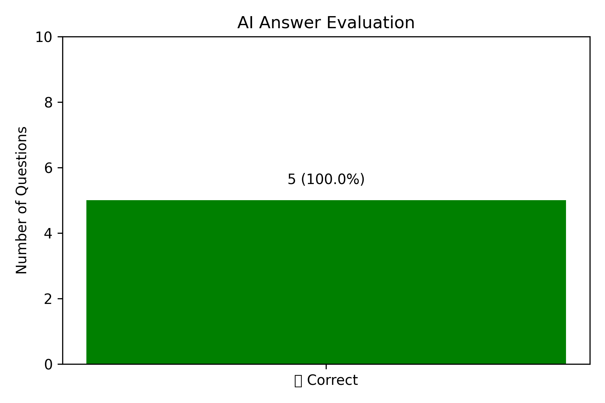
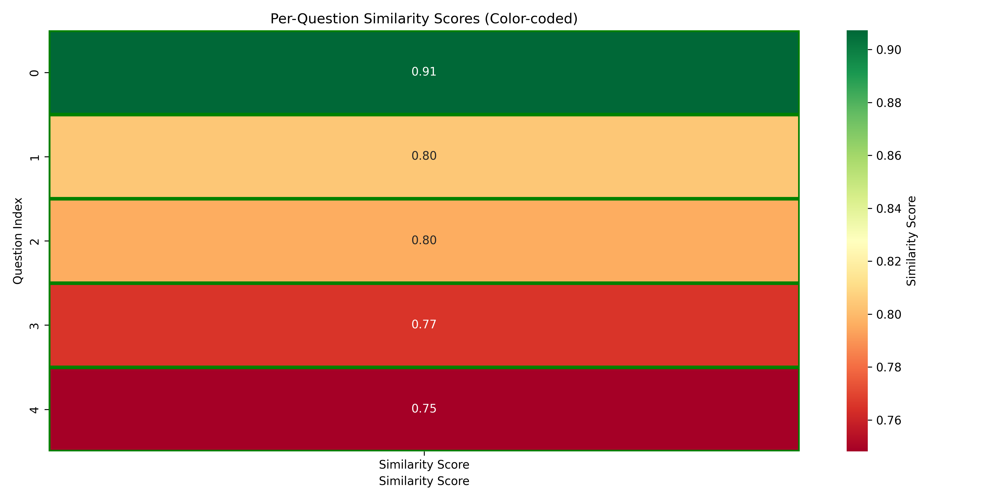
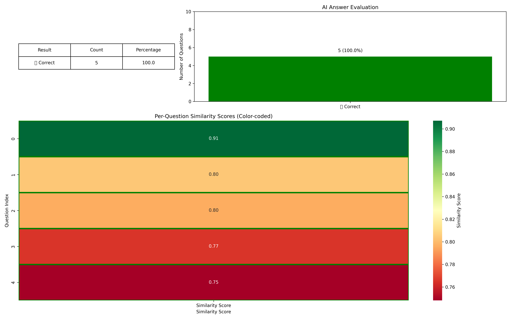

# AI Hallucination Detector

**A Sentence-BERT semantic-similarity prototype for comparing AI-generated answers with reference answers.**

This repository explores whether sentence embeddings can flag potentially inconsistent answers in a question-answering dataset. It uses the pretrained **`all-MiniLM-L6-v2`** model to encode reference and AI-generated answers and compares them using cosine similarity.

> **Research note:** Semantic similarity is not the same as factual correctness. The current prototype is a baseline experiment—not a reliable factual hallucination detector. A fluent but false answer can receive a high similarity score.

## Overview

The script reads pairs of **correct answers** and **AI answers**, calculates sentence-embedding similarity, and assigns a provisional label based on a fixed cutoff. It prints a score and label for each input row.

### How it works

```text
Reference answer + AI-generated answer
                 |
                 v
Sentence-BERT (all-MiniLM-L6-v2)
                 |
                 v
      Cosine similarity
                 |
                 v
      Fixed threshold: 0.60
          /             \
  score < 0.60      score >= 0.60
  "Hallucination"      "Correct"
```

The labels above are the script's heuristic outputs, **not verified judgments of truth**.

## Features

- Pretrained sentence embeddings using Sentence-Transformers.
- Cosine similarity between reference and generated answers.
- Adjustable similarity threshold (currently hard-coded to **0.60**).
- A built-in demonstration example.
- Batch processing from a CSV containing question-answer pairs.
- Per-question labels and numeric similarity scores printed to the terminal.
- Sample CSV results and visualization images included in the repository.

## Tech stack

- Python
- Sentence-Transformers / Sentence-BERT
- Scikit-learn
- Pandas

## Repository contents

| File | Purpose |
| --- | --- |
| `hallucination_detector.py` | Sentence embedding, similarity scoring, and CSV evaluation loop |
| `truthfulqa_sample.csv` | Five example question-answer pairs |
| `hallucination_results_fast.csv` | Previously saved scores and predictions |
| `hallucination_bar_chart.png` | Included visualization |
| `hallucination_heatmap.png` | Included visualization |
| `combined_results_colored_figure_fast.png` | Included visualization |
| `requirements.txt` | Dependency file (currently needs cleanup; see setup note below) |
| `LICENSE` | Project license |

## Getting started

Clone the repository and navigate into the project:

```bash
git clone https://github.com/AnupaLodhi/ai-hallucination-detector.git
cd ai-hallucination-detector
```

Create and activate a virtual environment (macOS/Linux):

```bash
python3 -m venv .venv
source .venv/bin/activate
```

Install the packages used directly by the script:

```bash
python -m pip install sentence-transformers scikit-learn pandas
```

> **Setup note:** The committed `requirements.txt` currently contains Git shell commands alongside package specifications, so it is not a clean pip requirements file. The command above is the recommended starting point until that file is corrected.

Run the experiment from the repository root:

```bash
python hallucination_detector.py
```

The first run may download the pretrained model. The script prints results to the terminal; it does not currently create the supplied chart images or automatically export a results CSV.

## CSV input format

The code expects a file named `truthfulqa_sample.csv` with the columns:

```csv
question,correct_answer,ai_answer
Who discovered gravity?,Isaac Newton discovered the law of gravity,Albert Einstein discovered gravity
What is the capital of France?,Paris is the capital of France,London is the capital of France
```

You can edit the CSV while preserving these three column names.

## Existing sample results

The committed `hallucination_results_fast.csv` contains five examples that have factually incorrect AI answers. Nevertheless, **all five are labeled `✅ Correct`** because their cosine similarity scores exceed 0.60.

| Example | Saved similarity | Saved label |
| --- | ---: | --- |
| Newton vs. Einstein | 0.7653 | ✅ Correct |
| Paris vs. London | 0.7955 | ✅ Correct |
| Shakespeare vs. Marlowe | 0.7481 | ✅ Correct |
| Jupiter vs. Venus | 0.8036 | ✅ Correct |
| 1776 vs. 1775 | 0.9073 | ✅ Correct |

These saved outputs illustrate why similarity-only thresholds can miss factual substitutions, including named entities and dates. They should **not** be interpreted as evidence of high detection accuracy.

## Included visualizations







The plots are existing repository assets; the current script does not regenerate them.

## Limitations and next steps

- **Factuality:** High semantic similarity can hide false names, places, dates, or quantities.
- **Ground truth:** Add manual factual correctness labels and evaluate precision, recall, F1, and a confusion matrix.
- **Calibration:** Tune decision thresholds on held-out labeled examples rather than setting one arbitrarily.
- **Better verification:** Compare with entailment/NLI methods, evidence retrieval, and claim-level factual verification.
- **Reproducibility:** Clean and test the dependency specification; add a documented evaluation script and regenerate charts from results.

## Academic purpose

This is an educational and research prototype exploring the limits of semantic similarity as a hallucination-detection signal. It is not a production-grade answer verification system.

## License

See [LICENSE](LICENSE).
